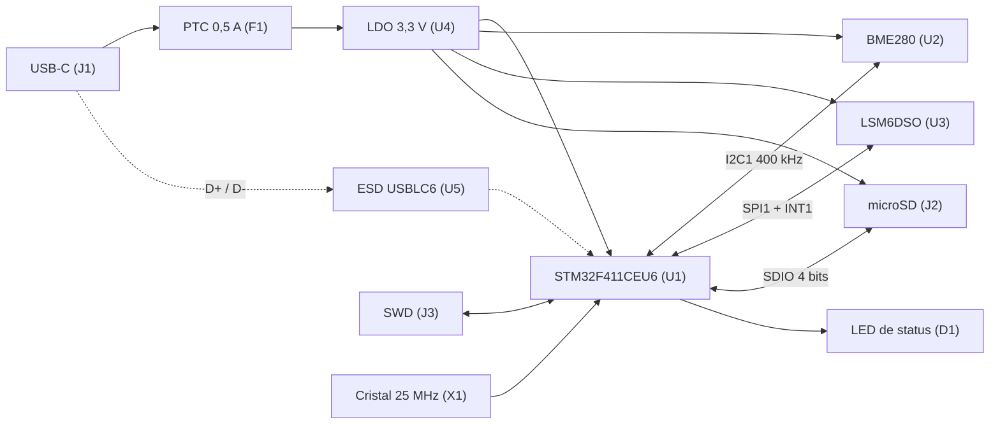
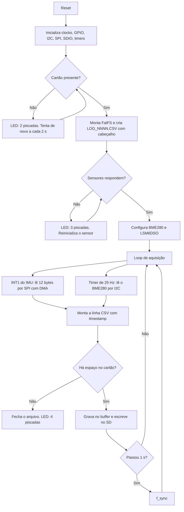

# Datalogger Ambiental e Inercial com STM32

Projeto de hardware e firmware embarcado para o processo seletivo da **Payload** da EPTA (Equipe de Propulsão e Tecnologia Aeroespacial, UFU).
A placa registra, durante o voo de um foguete, **temperatura, umidade e pressão** (BME280) e **aceleração e velocidade angular** (LSM6DSO) em um **cartão microSD**, em arquivos CSV, usando um **STM32F411CEU6**.

**Candidato:** Lucas Marques Coelho · Engenharia de Controle e Automação
**Repositório:** `https://github.com/lucas-marquesc/payload-datalogger-stm32`


---


## Sumário

1. [Arquitetura](#arquitetura)
2. [Estrutura do repositório](#estrutura-do-repositório)
3. [Seleção de componentes](#seleção-de-componentes)
4. [Pinagem](#pinagem)
5. [Esquemático](#esquemático)
6. [PCB](#pcb)
7. [Firmware](#firmware)
8. [Orçamento de energia](#orçamento-de-energia)
9. [Validação](#validação)
10. [Decisões, riscos e limitações](#decisões-riscos-e-limitações)
11. [Referências](#referências)

---

## Arquitetura



| Bloco | Componente | Interface |
|---|---|---|
| MCU | STM32F411CEU6 | — |
| Temperatura, umidade e pressão | BME280 | I²C (0x76) |
| IMU | LSM6DSO | SPI + INT1 (data-ready) |
| Armazenamento | Slot microSD | SDIO 4 bits |
| Energia | USB-C + PTC + LDO 3,3 V | — |
| Depuração | Header SWD 1×5 | SWDIO / SWCLK / NRST |

---

## Estrutura do repositório

```
/hardware	projeto do EasyEDA, Gerbers, BOM, posicionamento e PDF do esquemático
/firmware	projeto do STM32CubeIDE
/docs	diagrama de blocos, BOM com justificativas, fotos e testes
/scripts	análise dos CSVs em Python (plot_log.py)
PC README.md	este arquivo

```

---

## Seleção de componentes

A lista completa, com designadores, encapsulamentos e justificativa de cada item, está em [`docs/BOM.md`](docs/BOM.xlsx): **25 linhas, 52 componentes**. Os principais:

| Componente | Por que foi escolhido |
|---|---|
| **STM32F411CEU6** (UFQFPN-48) | Cortex-M4 a 100 MHz, 512 kB de flash, SDIO, USB FS, SPI, I²C e RTC. É a sugestão do desafio e o encapsulamento é compacto. |
| **BME280** (LGA-8) | Temperatura, umidade e pressão em um chip, em I²C. Precisão típica de ±1 °C, ±3 %RH e ±1 hPa. Driver oficial da Bosch. |
| **LSM6DSO** (LGA-14L) | Acelerômetro e giroscópio com SPI de até 10 MHz e INT1 de data-ready. Faixas de ±16 g e ±2000 dps. Mais barato e fácil de encontrar que o ICM-42688-P, com driver oficial da ST. |
| **AP2112K-3.3** (SOT-23-5) | LDO de 600 mA com baixa queda de tensão, suficiente para o pico de escrita do SD. |
| **USBLC6-2SC6** | Proteção ESD de D+, D− e VBUS. |
| **USB-C 16 pinos** | Entrega 5 V e dados USB 2.0 (DFU e CDC). Mais fácil de montar que o de 24 pinos. |
| **Slot microSD com detecção** | Acesso aos 4 bits de dados e chave mecânica de detecção de cartão. |

O desafio permite trocar componentes desde que se mantenham I²C e SPI. O LSM6DSO substitui o ICM-42688-P por custo e disponibilidade; o protocolo (SPI com INT) é o mesmo.

---

## Pinagem

Numeração do encapsulamento UFQFPN-48. O STM32F411CEU6 de 48 pinos **não tem** PC8 a PC12 nem PD2, que são os pinos padrão do SDIO. Por isso o SDIO usa pinos alternativos (AF12) e o IMU usa o SPI1 em pinos que não conflitam com ele.

| Função | Sinal | Pino | Nº | Observação |
|---|---|---|---|---|
| SDIO | CMD | PA6 | 16 | Pull-up de 47 kΩ |
| SDIO | CLK | PB15 | 28 | |
| SDIO | D0 | PB7 | 43 | Pull-up de 47 kΩ |
| SDIO | D1 | PA8 | 29 | Pull-up de 47 kΩ |
| SDIO | D2 | PA9 | 30 | Pull-up de 47 kΩ; VBUS sensing do USB desativado |
| SDIO | D3 | PB5 | 41 | Pull-up de 47 kΩ |
| Detecção de cartão | SD_CD | PB12 | 25 | Pull-up externo de 10 kΩ (R14); chave do slot ao GND |
| IMU (SPI1) | SCK | PB3 | 39 | |
| IMU (SPI1) | MISO | PB4 | 40 | |
| IMU (SPI1) | MOSI | PA7 | 17 | |
| IMU (SPI1) | CS | PA4 | 14 | GPIO; pull-up de 10 kΩ |
| IMU | INT1 | PB1 | 19 | EXTI1 (data-ready) |
| BME280 (I²C1) | SCL | PB8 | 45 | Pull-up de 4,7 kΩ |
| BME280 (I²C1) | SDA | PB9 | 46 | Pull-up de 4,7 kΩ |
| USB | D− / D+ | PA11 / PA12 | 32 / 33 | Via USBLC6-2SC6 |
| SWD | SWDIO / SWCLK | PA13 / PA14 | 34 / 37 | Header 1×5 |
| LED de status | LED | PA1 | 11 | 1 kΩ em série |
| Botão de usuário | BTN | PA0 | 10 | EXTI0; botão ao GND com pull-up interno |
| Reset | NRST | NRST | 7 | 100 nF + botão |
| Boot | BOOT0 / BOOT1 | BOOT0 / PB2 | 44 / 20 | Pull-downs de 10 kΩ; botão do BOOT0 para o 3V3 |
| Clock | HSE | PH0 / PH1 | 5 / 6 | 25 MHz |
| Clock | LSE | PC14 / PC15 | 3 / 4 | Não usados (sem conexão) |

O INT1 do IMU fica no PB1 (EXTI1) porque PA0 e PB0 compartilham a EXTI0 e o PA0 é o botão. O debug usa apenas Serial Wire; PB3 e PB4 são liberados do JTAG para o SPI1.

---

## Esquemático

Arquivo: [`hardware/schematic.pdf`](hardware/schematic.pdf) · ERC: **0 erros e 0 avisos**

**Energia.** O 5 V do USB-C (rede VBUS) passa pelo PTC de 0,5 A (F1, MF-MSMF050-2) e segue, como rede +5V, para o LDO AP2112K-3.3 (U4), com 10 µF na entrada (C10) e na saída (C1); o pino EN está ligado à entrada. CC1 e CC2 têm 5,1 kΩ (R5 e R6) ao GND, o que faz a fonte liberar os 5 V. O USBLC6-2SC6 (U5) protege D+, D− e VBUS, do lado do conector, antes do PTC. A carcaça do conector vai ao GND. O LED vermelho D2 indica 3,3 V presente.

**MCU.**
- 100 nF em cada um dos três VDD (pinos 24, 36 e 48).
- VDDA (rede +3,3VA) filtrado com ferrite (L1), 1 µF (C8) e 100 nF (C7).
- VBAT ligado ao 3,3 V com 100 nF.
- VCAP_1 (pino 22) com 4,7 µF (C6).
- Cristal de 25 MHz (X1) com 18 pF (C11 e C12) para o HSE. O LSE (PC14 e PC15) não é usado.
- NRST com 100 nF (C9) e botão SW1; BOOT0 (R1) e BOOT1/PB2 (R2) com pull-down de 10 kΩ; botão SW2 no BOOT0 para o 3V3 (DFU).
- Pad térmico (EP, pino 49) ligado ao GND.

**BME280.** I²C1 com pull-ups de 4,7 kΩ (R7 no SDA e R8 no SCL). CSB no 3V3 (modo I²C) e SDO no GND (endereço 0x76). 100 nF junto ao chip.

**LSM6DSO.** SPI1 de quatro fios, CS com pull-up de 10 kΩ (R15) e INT1 no PB1. 100 nF em VDD e em VDDIO.

**microSD.** SDIO de 4 bits com pull-ups de 47 kΩ (R9 a R13) em CMD e D0 a D3, chave de detecção no PB12 com pull-up de 10 kΩ (R14), 100 nF e 10 µF no VDD do slot. O CLK não tem pull-up.

**Interface.** SWD em header 1×5 (J3: GND, NRST, SWCLK, SWDIO, 3V3, do pino 1 ao 5), LED verde de status (D1), botão de usuário (SW3) e três pontos de teste: T1 = 3V3, T2 = +5V e T3 = GND.

---


Regras adotadas no layout:

| Regra | Motivo |
|---|---|
| 2 camadas, com a inferior como **plano de GND contínuo** | Referência de retorno de baixa impedância e menos ruído. |
| Capacitores de desacoplamento a poucos milímetros de cada pino de alimentação, na mesma face do MCU | Reduz a indutância do laço de corrente. |
| **BME280 no canto oposto** ao LDO e ao MCU, com recorte (slot) na placa ao redor | O calor do LDO e do MCU distorce a temperatura. |
| LDO com cobre de GND generoso | Dissipa o calor do pior caso (ver [Orçamento de energia](#orçamento-de-energia)). |
| Trilhas SDIO curtas e de comprimento parecido (diferença alvo de até 5 mm) | Pedido do desafio; a 24 MHz a tolerância real é folgada. |
| SPI e I²C curtos, longe dos cristais | Menos acoplamento de ruído. |
| Cristais perto do MCU, com anel de GND e sem trilhas passando por baixo | Estabilidade do oscilador. |
| D+ e D− curtas, paralelas e sem vias | USB full-speed. |
| Slot microSD na borda da placa e USB-C na borda oposta | Acesso ao cartão e ao cabo. |
| Furos de fixação M3 nos cantos e eixos do IMU marcados na serigrafia | Alinhar o IMU com o eixo do foguete na montagem. |
| BME280 próximo a um furo de ventilação da estrutura | A pressão medida é a do ambiente externo. |

Arquivos de fabricação: Gerbers, BOM (`hardware/BOM_Board1_PCB.xlsx`) e arquivo de posicionamento (pick-and-place), todos gerados pelo EasyEDA.

---

## Firmware

Projeto do STM32CubeIDE em [`firmware/`](firmware/). Esta seção descreve o **projeto** do firmware. 

### Fluxo de funcionamento



### Configuração dos periféricos

| Periférico | Configuração | Motivo |
|---|---|---|
| Clock | HSE 25 MHz, PLL com M = 25, N = 192, P = 2, Q = 4: **96 MHz** de sistema e **48 MHz** para USB e SDIO | 1 MHz na entrada do PLL e 48 MHz exatos para USB e SDIO. |
| Barramentos | APB1 a 48 MHz (÷2) e APB2 a 96 MHz (÷1) | Respeita os limites do STM32F411. |
| I²C1 | 400 kHz (fast mode), PB8/PB9 | BME280 aceita. |
| SPI1 | Master, modo 3 (CPOL = 1, CPHA = 1), prescaler ÷16: **6 MHz**, DMA | O LSM6DSO aceita até 10 MHz. |
| SDIO | 4 bits, 24 MHz (48 MHz ÷ 2), FatFS | Maior taxa com margem de sinal. |
| EXTI1 | Borda de subida em PB1 | Data-ready do IMU, sem polling. |
| TIM3 | Interrupção de 25 Hz | Cadência de leitura do BME280. |
| USB | Modo dispositivo (CDC e DFU), VBUS sensing desativado | PA9 é usado como SDIO_D2. |

### Sensores

- **LSM6DSO:** acelerômetro e giroscópio a 208 Hz, ±16 g e ±2000 dps, com INT1 sinalizando dado novo. Uma única leitura em rajada de 12 bytes, a partir de `OUTX_L_G` (0x22), traz o giroscópio e o acelerômetro. Conversão para unidades físicas com as sensibilidades do datasheet (0,488 mg/LSB em ±16 g e 70 mdps/LSB em ±2000 dps). Na inicialização, o `WHO_AM_I` (0x0F) deve retornar 0x6C.
- **BME280:** modo normal a 25 Hz, oversampling ×1. Na inicialização, o registrador de ID (0xD0) deve retornar 0x60. A compensação usa os coeficientes de calibração lidos do próprio chip, com a rotina oficial da Bosch.
- **Taxa de gravação:** uma linha por amostra do IMU. O último valor do BME280 se repete nas linhas entre duas leituras dele.

### Formato do CSV

Arquivos `LOG_0001.CSV`, `LOG_0002.CSV` e assim por diante (nomes 8.3, sem nome longo no FatFS). O `timestamp_ms` conta o tempo desde a energização, pois a placa não tem cristal de 32,768 kHz nem bateria para manter um relógio absoluto.

```
timestamp_ms,temp_C,hum_pct,press_hPa,ax_g,ay_g,az_g,gx_dps,gy_dps,gz_dps,status
1520,24.31,48.2,911.84,0.012,-0.008,1.003,0.12,-0.05,0.01,3
```

`status` é uma máscara de bits: bit 0 = BME280 ok, bit 1 = IMU ok. A taxa de 208 linhas por segundo gera cerca de 15 kB/s, ou seja, uns 56 MB por hora. Para ler com pandas, use `pd.read_csv(arquivo)`.

### Tratamento de erros e LED de status

| Situação | Comportamento | LED (D1) |
|---|---|---|
| Inicializando | Configura periféricos | Aceso fixo |
| Gravando normalmente | Escreve e sincroniza a cada 1 s | 1 piscada curta por segundo |
| Cartão ausente | Não grava; tenta montar a cada 2 s e segue lendo os sensores | 2 piscadas e pausa |
| Falha de sensor | Tenta reinicializar; os campos do sensor ficam vazios e o bit correspondente do `status` vai a 0 | 3 piscadas e pausa |
| Cartão cheio | Confere o espaço livre antes de gravar; fecha o arquivo e para | 4 piscadas e pausa |
| Erro de escrita ou do sistema de arquivos | Fecha o arquivo e tenta remontar o cartão | 5 piscadas e pausa |

### Bibliotecas

| Biblioteca | Uso |
|---|---|
| STM32CubeF4 (HAL e LL) | Configuração de clocks, GPIO, I²C, SPI, SDIO, DMA e timers. |
| FatFS (middleware do CubeMX) | Sistema de arquivos FAT no microSD. |
| BME280 Sensor API (Bosch) | Compensação de temperatura, umidade e pressão. |
| lsm6dso-pid (ST) | Leitura e configuração do IMU. |
| pandas e matplotlib | Análise e gráficos dos CSVs em `scripts/`. |

### Como compilar e gravar

1. Instale o **STM32CubeIDE** e o **STM32CubeProgrammer**. Versões usadas: [PREENCHER].
2. Clone o repositório: `git clone https://github.com/lucas-marquesc/payload-datalogger-stm32.git`.
3. No CubeIDE: **File → Import → Existing Projects into Workspace**, e selecione a pasta `firmware/`.
4. Compile com **Project → Build All** (Ctrl+B). O binário sai em `firmware/Debug/`.
5. **Gravação por SWD:** ligue um ST-Link ao header J3 (pinos 1 a 5: GND, NRST, SWCLK, SWDIO, 3V3) e use **Run → Debug**, ou o STM32CubeProgrammer em modo SWD.
6. **Gravação por USB (DFU):** segure o botão BOOT0 (SW2), pressione e solte o reset (SW1), solte o BOOT0 e grave o `.bin` pelo STM32CubeProgrammer em modo USB.

---

## Orçamento de energia

Valores aproximados, a confirmar nos datasheets, para dimensionar o LDO.

| Consumidor | Corrente estimada (pior caso) |
|---|---|
| STM32F411 a 96 MHz com periféricos | 30 mA |
| microSD em escrita | 150 mA |
| LSM6DSO em alta performance | 1 mA |
| BME280 a 25 Hz | 1 mA |
| LEDs (D1 e D2) | 3 mA |
| **Total** | **≈ 185 mA** |

O LDO de 600 mA tem folga de mais de três vezes. Em contrapartida, a dissipação no pior caso é (5,0 V − 3,3 V) × 0,185 A ≈ **0,31 W**, o que é muito para um SOT-23-5. A média é bem menor, porque o SD só consome muito em rajadas, mas esse é o motivo do cobre de GND generoso e da distância entre o LDO e o BME280. Se a medição de temperatura ficar comprometida, a alternativa é trocar o LDO por um conversor buck pequeno.

---

## Validação

### Verificação feita no projeto

| Item | Como | Status |
|---|---|---|
| ERC limpo | Rodar no EasyEDA até zerar | Feito: 0 erros e 0 avisos |
| DRC limpo | Rodar no EasyEDA até zerar | [PREENCHER] |
| Footprints vs datasheet | Conferência pino a pino de cada componente | [PREENCHER] |
| Netlist vs pinagem | Netlist exportada do EasyEDA conferida rede a rede com a tabela de pinagem | Feito para o esquemático; falta cruzar com o CubeMX |
| Orçamento de energia | Tabela acima | Feito (estimativa) |
| Firmware compila sem erros | Build no CubeIDE | [PREENCHER] |
| Compensação do BME280 | Teste no PC com dados de calibração fictícios | [PREENCHER] |
| Script de análise | Gerar CSV sintético e plotar com `scripts/plot_log.py` | [PREENCHER] |


---

## Decisões, riscos e limitações

- **SDIO em pinos alternativos.** O UFQFPN-48 não tem os pinos padrão do SDIO. A solução usa PA6, PB15, PB7, PA8, PA9 e PB5. O custo é abrir mão do VBUS sensing do USB (PA9) e posicionar o SPI1 em PB3, PB4 e PA7.
- **PTC em 1812.** O fusível rearmável F1 é maior que os demais passivos (4,5 × 3,2 mm) e precisa de espaço perto do conector USB-C.
- **Passivos 0201.** Os capacitores de 100 nF e 18 pF usam o encapsulamento 0201, adequado a montagem automatizada e pequeno demais para solda manual.
- **LDO.** A dissipação no pior caso é alta para o encapsulamento (ver [Orçamento de energia](#orçamento-de-energia)).
- **Faixa do BME280.** A pressão só é válida de 300 a 1100 hPa, o que corresponde a cerca de 9 km de altitude. Acima disso, a leitura deixa de ser confiável.
- **Alimentação em voo.** O projeto prevê apenas a entrada USB-C de 5 V (por exemplo, com um power bank). Não há entrada de bateria nem carregador. Seria o próximo passo para um voo real.
- **Cartão SD sob vibração.** O slot push-push pode soltar o cartão. Em voo, convém prender o cartão ou usar um slot com trava.


---

## Referências

**Datasheets e notas de aplicação**

- STMicroelectronics. *STM32F411xC/xE Datasheet (DS10314)*. https://www.st.com/resource/en/datasheet/stm32f411re.pdf
- STMicroelectronics. *RM0383, STM32F411xC/E Reference Manual*. https://www.st.com
- STMicroelectronics. *AN4488, Getting started with STM32F4xxxx MCU hardware development*. https://www.st.com
- STMicroelectronics. *AN2867, Oscillator design guide for STM8AF/AL/S and STM32 microcontrollers*. https://www.st.com
- STMicroelectronics. *AN2606, STM32 microcontroller system memory boot mode*. https://www.st.com
- Bosch Sensortec. *BME280 Datasheet (BST-BME280-DS002)*. https://www.bosch-sensortec.com
- STMicroelectronics. *LSM6DSO Datasheet*. https://www.st.com
- Diodes Incorporated. *AP2112 Datasheet*. https://www.diodes.com
- STMicroelectronics. *USBLC6-2 Datasheet*. https://www.st.com
- NXP. *UM10204, I²C-bus specification and user manual*. https://www.nxp.com
- USB Implementers Forum. *USB Type-C Cable and Connector Specification*. https://www.usb.org
- SD Association. *SD Physical Layer Simplified Specification*. https://www.sdcard.org

**Software e bibliotecas**

- STM32CubeF4 (HAL e LL). https://github.com/STMicroelectronics/STM32CubeF4
- FatFS, ChaN. http://elm-chan.org/fsw/ff/
- Bosch Sensortec. BME280 Sensor API. https://github.com/boschsensortec/BME280_SensorAPI
- STMicroelectronics. lsm6dso-pid. https://github.com/STMicroelectronics/lsm6dso-pid
- EasyEDA, documentação oficial. https://docs.easyeda.com

**Estrutura do README**

- Repositórios públicos de candidatos de desafios anteriores da EPTA, consultados apenas como referência de organização do README:
  - https://github.com/jvfaria-dev/Desafio-de-Din-mica-de-Voo---Processo-Seletivo-EPTA
  - https://github.com/GabrielAraujoBicalho/Projeto-EPTA---Compara-o-e-an-lise-de-voo-Nashira.
